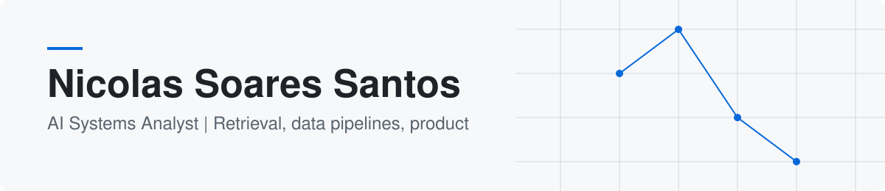

<picture>
  <source media="(prefers-color-scheme: dark)" srcset="assets/banner-dark.svg">
  <source media="(prefers-color-scheme: light)" srcset="assets/banner-light.svg">
  
</picture>

I build AI systems on top of a solid data foundation: retrieval-augmented generation,
data pipelines and the product layer around them. São Paulo, Brazil.

## Now

- **Building:** LIA, Pluxee's internal AI assistant. RAG over Elasticsearch and OpenAI, multi-tenant access control, chat, WhatsApp and voice channels.
- **Documenting:** system architecture (C4 views, ADRs, glossary) and the design-system layer of the product.
- **Studying:** B.Sc. in Computer Science at Universidade Presbiteriana Mackenzie (2026 to 2029).
- **Background:** four years in Operations Performance at Pluxee: Python pipelines, Power BI models and dimensional modeling on BigQuery.

## Selected work

| Project | Outcome | Stack |
| :-- | :-- | :-- |
| [Portfolio](https://portfolio.nicolassoares-santos.workers.dev) | Trilingual site (EN, PT, ES) with a Material Design 3 system built in-repo; project pages are ingested from each repository. | React 19, TypeScript, Hono, Cloudflare Workers, R2 |
| [Corporate Benefits Transactions](https://github.com/Nic-Soares/corporate-benefits-transactions) | Synthetic dataset of 5.7 million Brazilian benefit-card transactions, generated by a simulated issuer that approves or declines each purchase with ISO 8583 codes. | Python, Polars, PostgreSQL, DuckDB, Parquet |
| [Spotify Web](https://github.com/Nic-Soares/spotify-web) | Full-stack music catalog and player, from UI to API, database and deployment. | React 19, Vite, Express, MongoDB |

## Stack

<picture>
  <source media="(prefers-color-scheme: dark)" srcset="https://skillicons.dev/icons?i=py%2Cjava%2Cts%2Creact%2Cnextjs%2Cdotnet%2Cpostgres%2Cmongodb%2Celasticsearch%2Cdocker%2Cgit%2Cgitlab%2Caws%2Cazure%2Ccloudflare%2Cfigma%2Clinux&perline=16&theme=dark">
  <source media="(prefers-color-scheme: light)" srcset="https://skillicons.dev/icons?i=py%2Cjava%2Cts%2Creact%2Cnextjs%2Cdotnet%2Cpostgres%2Cmongodb%2Celasticsearch%2Cdocker%2Cgit%2Cgitlab%2Caws%2Cazure%2Ccloudflare%2Cfigma%2Clinux&perline=16&theme=light">
  
</picture>

## Certifications

